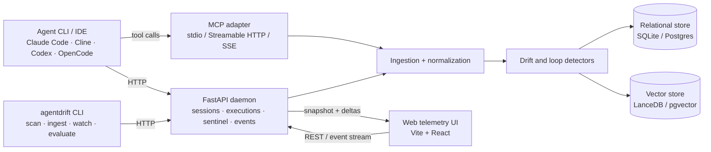

# AgentDrift architecture

AgentDrift is a runtime supervisor for coding-agent execution streams. It
stores step-level telemetry, checks adjacent actions for drift or repetition,
and exposes detections to an agent through REST, MCP, CLI, and a web interface.

## Component topology

The REST daemon defaults to local persistence: SQLite stores sessions,
executions, and detections; LanceDB stores 384-dimensional execution vectors.
With a configured SQL database URL, the daemon selects PostgreSQL. The
separate `agentdrift` MCP package exposes a common `BaseStore` over local
SQLite/LanceDB or Supabase Postgres/pgvector. Cloud MCP is independently
authenticated and should not be conflated with the dashboard daemon.

## Runtime lifecycle

1. The agent creates or selects a session.
2. Each tool/step result is normalized as an execution with sequence, input,
   output, optional state hash, and optional trace.
3. Ingestion stores the relational record and computes or stores an embedding.
4. The drift engine compares an execution with its predecessor and may persist
   a drift detection.
5. The sentinel scan checks adjacent executions for repeated state and returns
   `ping_pong_loop` detections.
6. The client receives the result synchronously through REST/MCP or observes
   stored records through the polling SSE stream.

## Detection mechanics: two related paths

The implementation has two related detector paths; they have different
threshold defaults and execution order.

### Execution drift on ingest

`app/drift.py:decide_drift` computes current/prior 384-D embeddings and cosine
similarity, then classifies evidence in this order:

1. If both state hashes are present and differ, return `state_drift`.
2. If both outputs are objects with differing key sets and similarity meets
   the drift threshold, return `schema_drift`.
3. Score prior/current outputs for contradiction; score ≥ 0.7 returns
   `logical_drift`.
4. Similarity below the drift threshold returns `semantic_drift`.
5. Otherwise return `no_drift`.

The drift threshold defaults to **0.85** (`DRIFT_SIMILARITY_THRESHOLD`). The
NLI cross-encoder is optional and disabled by default; a negation-flip
heuristic is used otherwise. This path is not the same as the sentinel scan.

### Sentinel circuit breaker

The `/v1/sentinel/scan` route and MCP circuit-breaker path compare neighboring
executions. A matching non-empty state hash is an immediate repeated-state
signal; the scan also computes cosine similarity around the sentinel threshold
(default **0.92**). The current in-memory daemon uses strict `>` for cosine,
while the hybrid and MCP store implementations use `>=`; a pair exactly on the
threshold can therefore differ by backend. LanceDB supplies vectors in the
hybrid path. NLI is not part of this ping-pong scan. Results include the
current/prior execution IDs, similarity, threshold, and reason evidence.

The trip line is a control signal to the consuming agent: stop repeating the
operation, inspect evidence, and recover deliberately. AgentDrift records and
reports detections; it does not cancel arbitrary external tools or roll back
their side effects.

## Embedding and storage boundaries

`sentence-transformers/all-MiniLM-L6-v2` produces 384-D embeddings when it is
available. A deterministic token-hash embedding is the offline fallback.
Supabase uses 384-D pgvector columns. The actual application does not currently
include FastEmbed, configurable LanceDB index parameters, or a separately
enforced DeBERTa stage in sentinel checks. See
[configuration](configuration_and_providers.md) and
[storage](memory_and_storage.md).

## Failure behavior

The daemon can run in process memory if persistence is unavailable, but that
mode is ephemeral. Model-loading failures fall back to hash embeddings or the
contradiction heuristic. Clients should treat incomplete/error responses as
unknown outcomes, inspect execution history before retrying mutations, and
avoid assuming at-least-once or exactly-once delivery over SSE.
